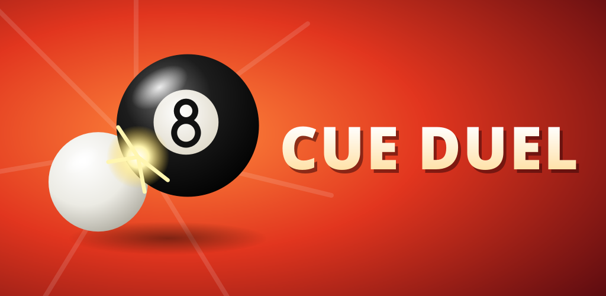

# Cue Duel

8-ball pool for Android, played against the computer or a friend on the same phone.



## Features

- 3D table with a top view and a camera behind the cue
- Computer opponent with four levels. Hard and Pro play every candidate shot through
  the simulation and care about where the cue ball ends up.
- Two players on one device
- 8-ball rules: break, open table, fouls (cue ball potted, wrong ball first, no rail
  after contact), ball in hand, 8 on the break goes back on the spot
- Replays of the last 12 games
- Statistics per AI level
- English, German, Spanish and Turkish
- No ads, no tracking, no internet permission

## Building

The game is made with [Godot 4.7](https://godotengine.org/).

1. Install Godot 4.7.2 and the Android export templates.
2. Point Godot to an Android SDK (Editor Settings, Export, Android).
3. Export:

```
godot --headless --export-release "Android" build/CueDuel.apk
```

The release keystore is read from the environment variables
`GODOT_ANDROID_KEYSTORE_RELEASE_PATH`, `GODOT_ANDROID_KEYSTORE_RELEASE_USER` and
`GODOT_ANDROID_KEYSTORE_RELEASE_PASSWORD`.

## Tests

The simulation, rules and AI run without graphics:

```
godot --headless --script tests/sim_test.gd
```

It lets the AI play itself on every level and checks that games finish, pockets work
and the physics is deterministic.

## License

GPL-3.0, see [LICENSE](LICENSE).
